# VeloceNet-Studio

[](https://github.com/Cadman021/VeloceNet-Studio/actions/workflows/ci.yml)
[](https://github.com/Cadman021/VeloceNet-Studio/releases/tag/v1.6.0)
[](LICENSE)
[]()
[]()
[]()

Cross-platform **network monitoring and analysis studio** built with **Flutter** + a **Rust engine (Tokio, via FFI)**.

Live latency matrix (ICMP / TCP / HTTP(S) with TTFB), visual traceroute, bandwidth monitor, Warp endpoint scanner, TCP port scanner and DNS lookup — with Light/Dark/System themes and English/فارسی/Русский/中文 UI.

> License: **GPL-3.0-or-later** — see [LICENSE](LICENSE).
>
> Read this in: [فارسی](README.fa.md) · [Русский](README.ru.md) · [中文](README.zh.md).

## Screenshots

> Screenshots live in [`docs/screenshots/`](docs/screenshots/). If an image is missing below, capture it with <kbd>Win</kbd>+<kbd>Shift</kbd>+<kbd>S</kbd> at 1600×900 and save it under that path.

| Ping Matrix (dark) | Ping Matrix (light) |
|---|---|
| 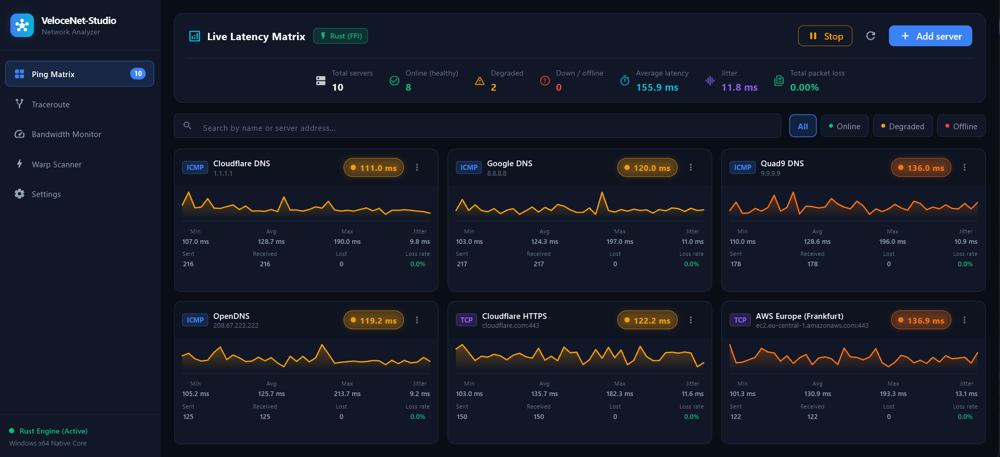 | 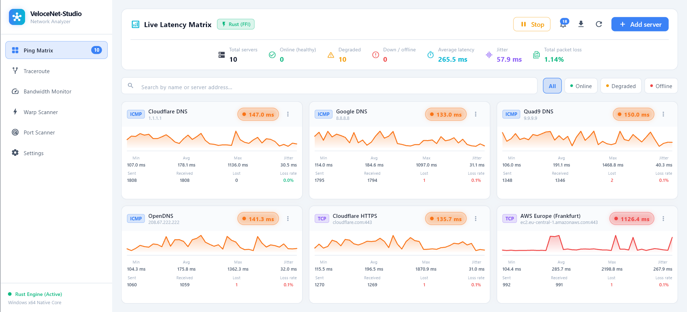 |

| Traceroute | Bandwidth |
|---|---|
| 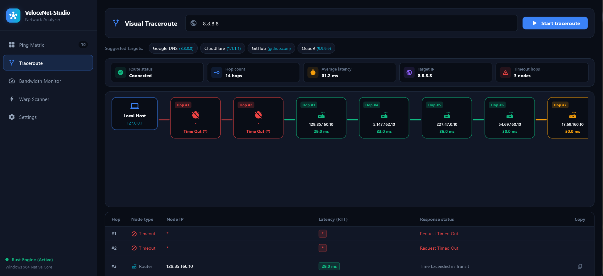 | 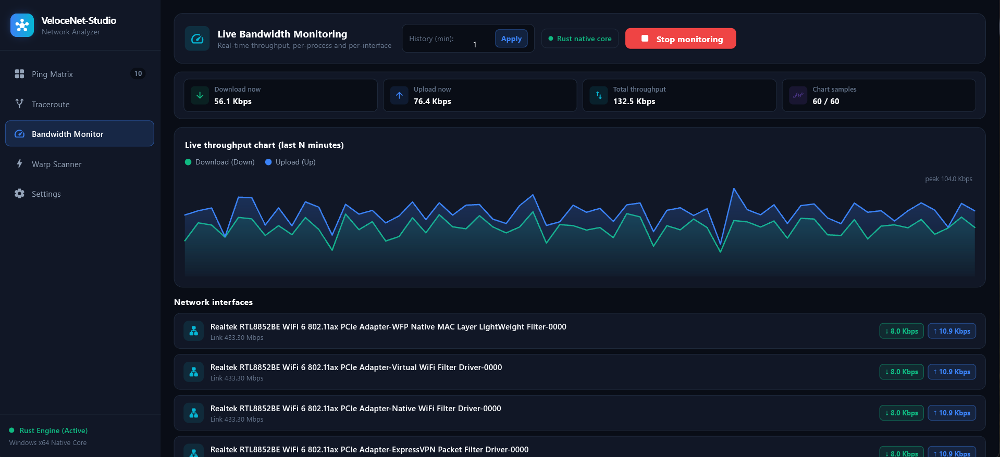 |

| Warp Scanner | Settings |
|---|---|
| 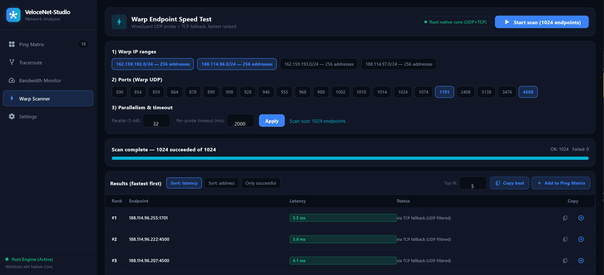 | 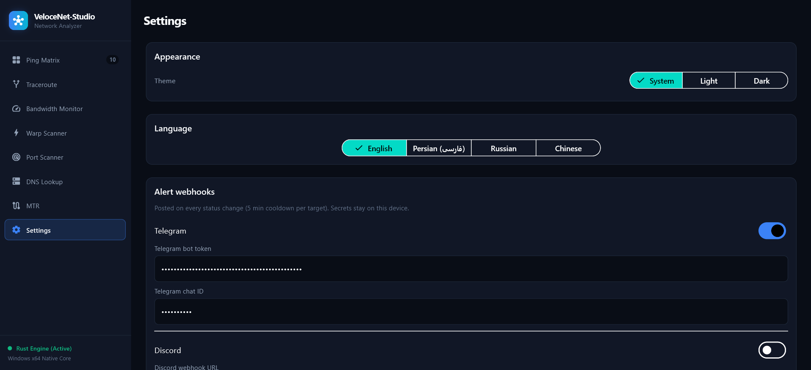 |

| Port Scanner | Alert log |
|---|---|
| 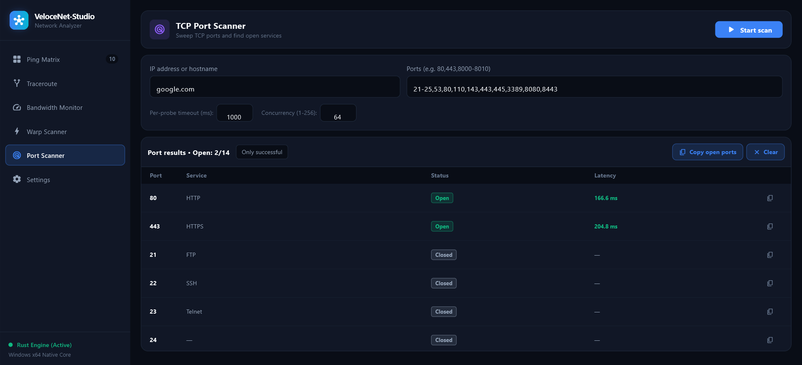 | 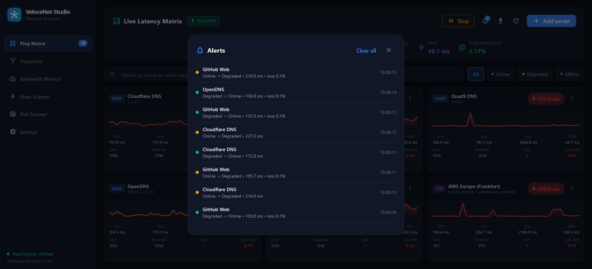 |

| DNS Lookup | Uptime history |
|---|---|
| 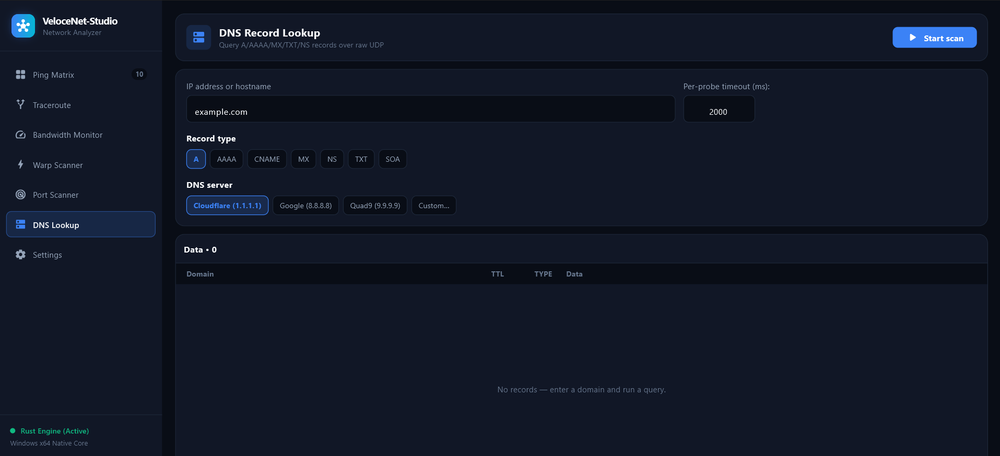 | 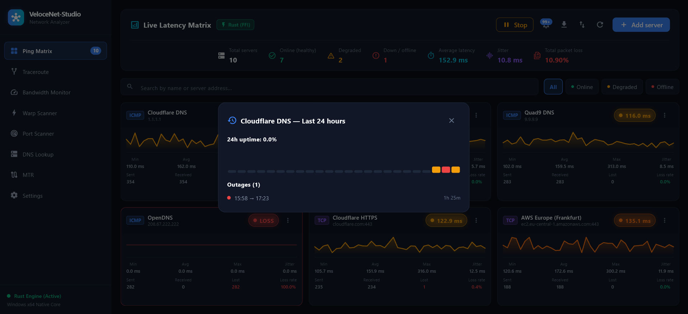 |

| MTR | Update prompt |
|---|---|
| 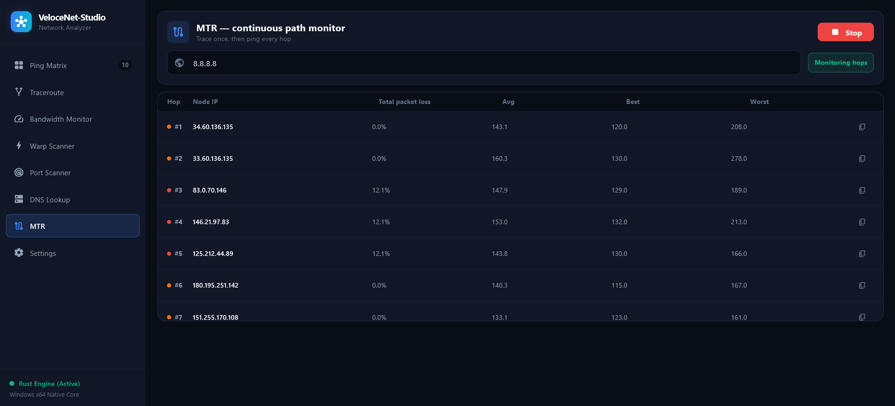 | 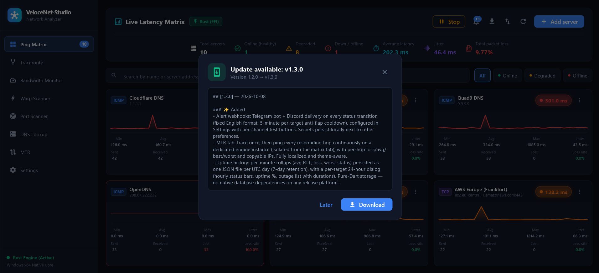 |

## Features

- **Ping Matrix** — concurrent ICMP (Windows IP Helper; unprivileged ping sockets on Linux/macOS — no admin/root needed) + TCP-handshake + HTTP(S) probes (TTFB, status code, TLS certificate expiry), live sparklines, RTT avg/min/max, RFC 3550 jitter, loss %, status-change **alert log** with unread badge, one-click **CSV export**, versioned **JSON backup** (export + paste-to-import), per-target **day / 7-day / 30-day uptime history** with window SLA, outage report and per-day drill-down, and **group/tag organization** with one-tap filter facets.
- **Traceroute** — TTL-based visual hop chain + data table (native ICMP: Windows IP Helper incl. IPv6, Linux/macOS ping sockets), reverse-DNS hop names, averaged multi-sample RTT, stopped early on destination-unreachable.
- **MTR** — trace once, then continuously ping every responding hop (loss/avg/best/worst per hop) on an isolated engine instance.
- **Bandwidth** — per-interface live deltas via `GetIfTable2` (64-bit counters), top processes by connection share (explicitly labeled *estimated*).
- **Warp Scanner** — WireGuard-style UDP probe + TCP fallback, ranking, copy-to-clipboard, one-click add to Ping Matrix; import a `.conf`/wgcf **WireGuard profile** to sign handshakes with your own identity and prove the endpoint accepts it (private key stays in memory, no tunnel is installed).
- **Port Scanner** — TCP sweep with port-list specs (`80,443,8000-8010`), open/closed/filtered states, service guesses.
- **DNS Lookup** — raw UDP client for A/AAAA/MX/TXT/NS/CNAME/SOA records against Cloudflare/Google/Quad9 or a custom server, with NXDOMAIN distinction and query-time display.
- **Settings** — Light / Dark / System theme + English / فارسی / Русский / 中文 locale, persisted with `shared_preferences` (default: English), plus Telegram/Discord/ntfy/generic alert webhooks (DPAPI-protected secrets on Windows), **native desktop notifications** and test buttons.
- **System tray** — close minimizes to the tray while monitoring continues; Show/Hide/Quit menu, toggleable in Settings.
- **Update checker** — daily GitHub Releases poll with a startup prompt dialog (Download/Later, once per version) and manual check in Settings.
- **Resilient engine** — if the Rust `.dll`/`.so` isn't built, the app automatically uses the Dart fallback prober so the UI stays usable.
- **Headless daemon** — the same engine ships as a standalone `netstudio-headless` binary for servers: reads the app's JSON targets, streams color-coded tables on a terminal (NDJSON when piped), writes atomic status files, reports sanitized failure reasons and staleness, and serves `/healthz`, `/readyz`, `/metrics` (Prometheus) and `/api/v1/status` without Flutter. See [docs/headless.md](docs/headless.md).

## Download (v1.6.0)

No build needed — pick your platform from the
[v1.6.0 release](https://github.com/Cadman021/VeloceNet-Studio/releases/tag/v1.6.0):

| Platform | File | Run |
|---|---|---|
| Windows x64 | `velocenet-studio-windows-x64.zip` | Extract, run the `.exe` (DLL bundled next to it) |
| Linux x64 | `velocenet-studio-linux-x64.tar.gz` | Extract, run the `netstudio` binary (`.so` bundled next to it) |
| macOS arm64 | `velocenet-studio-macos-arm64.zip` | Extract, right-click the `.app` → Open (unsigned build, one-time Gatekeeper approval) |

Native ICMP probing runs on Windows (IP Helper) and on Linux/macOS via unprivileged ping sockets; where the OS refuses them (e.g. a restrictive `ping_group_range`), probes transparently fall back to TCP. See [CHANGELOG.md](CHANGELOG.md) for what's in this release.

## Build from source (Windows)

Prerequisites: Flutter SDK ≥ 3.22 · Rust stable (`rustup`) · Windows 10/11 x64 for full native features.

```powershell
.\build_native.ps1      # cargo build --release + stage netstudio_engine.dll
flutter pub get
flutter run -d windows
```

Manual alternative:

```powershell
cd native_engine
cargo build --release
Copy-Item target\release\netstudio_engine.dll ..
cd ..
flutter run -d windows
```

Linux/macOS: `cargo build --release` produces `libnetstudio_engine.so` / `.dylib`; ICMP uses unprivileged ping sockets (SOCK_DGRAM) and falls back to TCP only where the OS refuses them.

The same build produces `native_engine/target/release/netstudio-headless` (`netstudio-headless.exe` on Windows), the standalone daemon. `build_native.ps1` copies it next to the app and the Windows runner output. See [docs/headless.md](docs/headless.md) for configuration, HTTP endpoints and a systemd unit.

## How it works

```
┌──────────── Flutter UI ────────────┐      ┌────────── Rust engine ──────────┐
│ Ping Matrix · Traceroute · MTR     │ JSON │ Tokio probers (ICMP/TCP/TLS)    │
│ Bandwidth · Warp · Portscan · DNS  │◄────►│ stats (RTT/jitter/loss)         │
│ SettingsController (theme+locale)  │  FFI │ traceroute / bandwidth / warp   │
└────────────────────────────────────┘      └─────────────────────────────────┘
```

- FFI boundary: `lib/core/ffi/` (Dart) ↔ `native_engine/src/ffi.rs` (C ABI). All strings are validated in Dart before crossing; numeric ranges are clamped on both sides.
- Native library is resolved from **absolute paths anchored at the running executable only** — never cwd/`PATH` (DLL-hijacking safe).
- State: `PingMatrixController`, `TracerouteController`, `BandwidthController`, `WarpController`, `SettingsController` (all `ChangeNotifier`-based).

## Project structure

```
lib/
  main.dart                      # async boot + SettingsController load
  core/ffi/                      # native_library.dart, native_bindings.dart
  core/theme/                    # app_colors.dart, app_theme.dart, theme_x.dart
  core/settings/                 # settings_controller.dart (theme+locale)
  core/i18n/                     # JSON-backed AppStrings (en/fa/ru/zh, default en)
  models/ services/ state/       # incl. alert_log.dart, desktop_notifier.dart, warp_profile.dart
  views/
    main_shell_view.dart         # sidebar + IndexedStack tabs
    ping_matrix/ traceroute/ bandwidth/ warp/ portscan/ dnslookup/ settings/
native_engine/src/
  engine.rs ffi.rs stats.rs probe/ traceroute.rs bandwidth.rs warp.rs
.github/workflows/              # ci.yml, release.yml
docs/screenshots/               # images used above
```

## Security notes

- No cwd/`PATH` DLL probing; missing engine → Dart fallback (never a crash).
- Warp scan input capped (256 KB / 4096 endpoints); IPv6 handled explicitly (bracketed `[::1]:port`).
- Per-process bandwidth is a **connection-share estimate** (Windows exposes no per-PID byte counters without ETW) — the UI labels it as such.
- Webhook secrets (Telegram token/chat ID, Discord URL) are DPAPI-protected on Windows and plaintext in the app preferences on Linux/macOS — a known, documented limitation, see [SECURITY.md](SECURITY.md).
- Imported WireGuard profile private keys are held **in memory for the current session only**: never written to preferences/disk, never logged or shown in the UI, and never used to install a tunnel. Re-import after restarting the app.
- Desktop notifications on Linux require `libnotify` (the release build links against it; the runtime library ships with normal desktop installs). On Windows, enabling notifications creates a Start-Menu shortcut so toast notifications get a valid AppUserModelID. On systems without a notification daemon the toggle reports "unavailable" instead of failing silently.
- Linux tray needs an appindicator host (`libayatana-appindicator` on GNOME); without one the app keeps running normally but close-to-tray is disabled automatically.

## Contributing

See [CONTRIBUTING.md](CONTRIBUTING.md). TL;DR:

```bash
flutter analyze --no-pub
flutter test --no-pub
cd native_engine && cargo test --release && cargo clippy --release -- -D warnings
```

Linux builds of the desktop-notification plugin require `libnotify-dev` (e.g. `sudo apt install libnotify-dev`).

New UI strings must go through the JSON dictionaries in `assets/lang/` (all four locales — `test/i18n_parity_test.dart` enforces it); new colors through `ThemeX`. Bug reports and feature requests use the issue templates.

## Changelog & roadmap

See [CHANGELOG.md](CHANGELOG.md). Near-term ideas: Prometheus export endpoint, real per-process accounting (ETW), Linux/macOS secret-store backends (libsecret/Keychain), additional network tools (speed test, DNS benchmark, TLS inspector).
