# VeloceNet-Studio

[](https://github.com/Cadman021/VeloceNet-Studio/actions/workflows/ci.yml)
[](https://github.com/Cadman021/VeloceNet-Studio/releases/tag/v1.3.0)
[](LICENSE)
[]()
[]()
[]()

Кроссплатформенная **студия мониторинга и анализа сети** на **Flutter** + **движке Rust (Tokio, через FFI)**.

Живая матрица задержек (ICMP / TCP), визуальный traceroute, мониторинг трафика, сканер Warp-эндпоинтов, TCP-сканер портов и DNS-запросы — со светлой/тёмной/системной темой и интерфейсом на английском/персидском/русском/китайском.

> Лицензия: **GPL-3.0-or-later** — см. [LICENSE](LICENSE).
>
> Read this in: [English](README.md) · [فارسی](README.fa.md) · [中文](README.zh.md).

## Скриншоты

> Скриншоты лежат в [`docs/screenshots/`](docs/screenshots/). Если картинки не хватает, снимите её (<kbd>Win</kbd>+<kbd>Shift</kbd>+<kbd>S</kbd>, 1600×900) и сохраните по этому пути.

| Пинг-матрица (тёмная) | Пинг-матрица (светлая) |
|---|---|
| 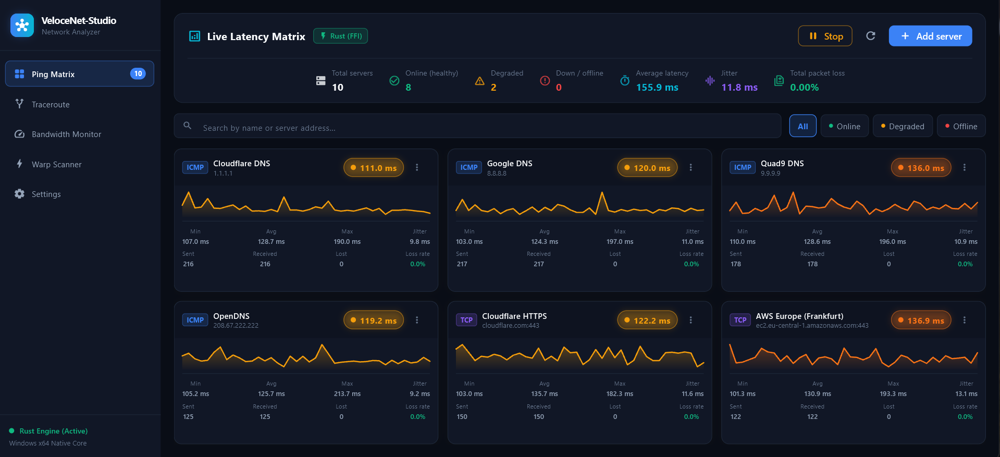 | 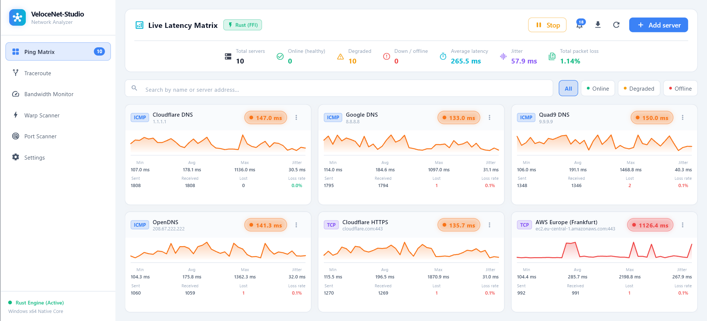 |

| Трассировка | Трафик |
|---|---|
| 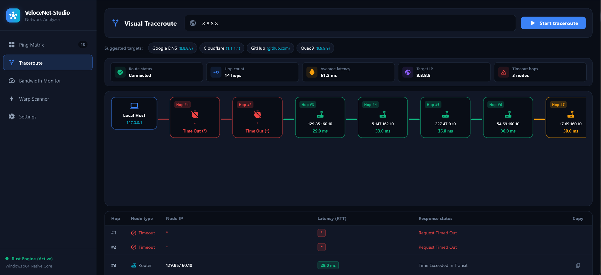 | 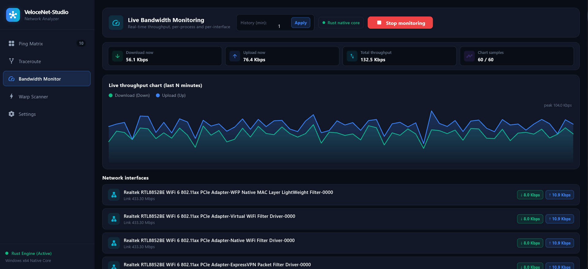 |

| Warp-сканер | Настройки |
|---|---|
| 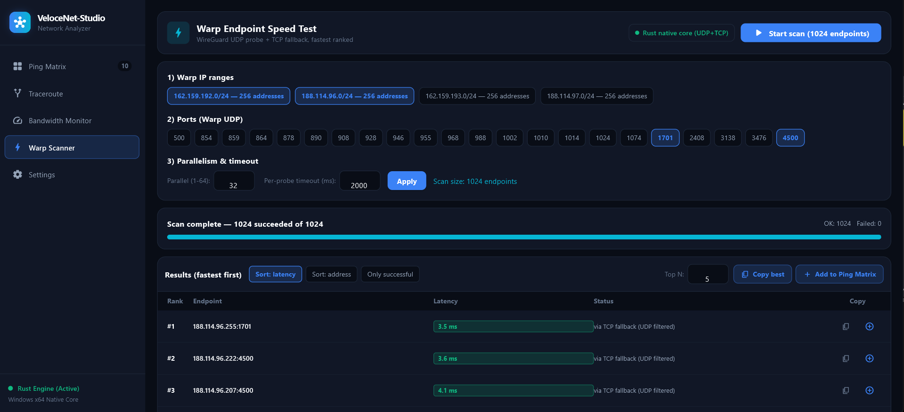 | 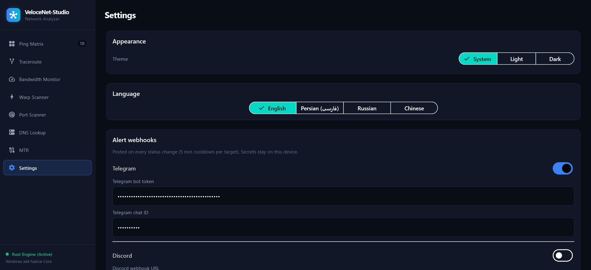 |

| Сканер портов | Журнал оповещений |
|---|---|
| 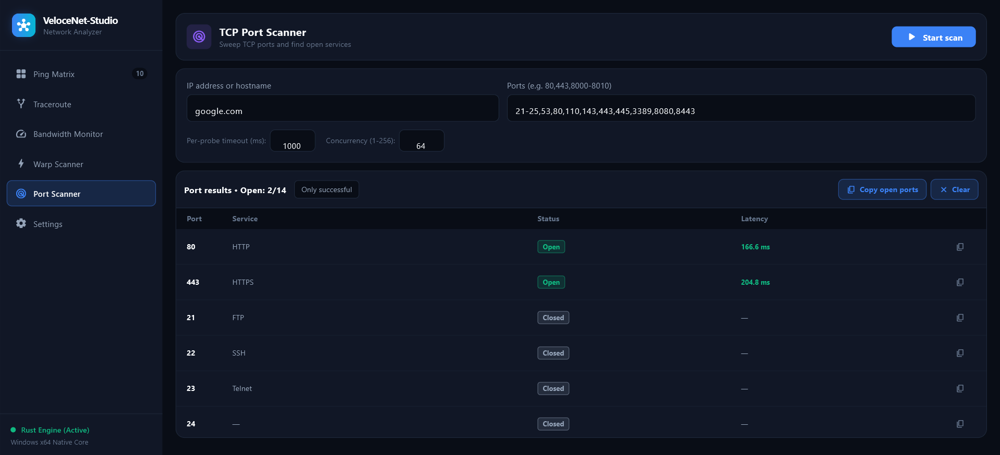 | 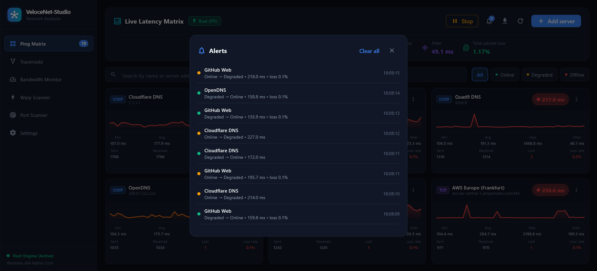 |

| DNS-запросы | История аптайма |
|---|---|
| 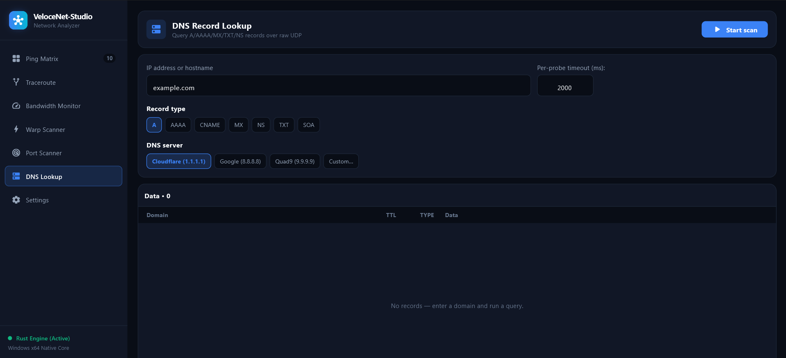 | 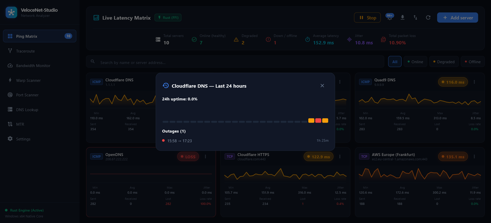 |

| MTR |
|---|
| 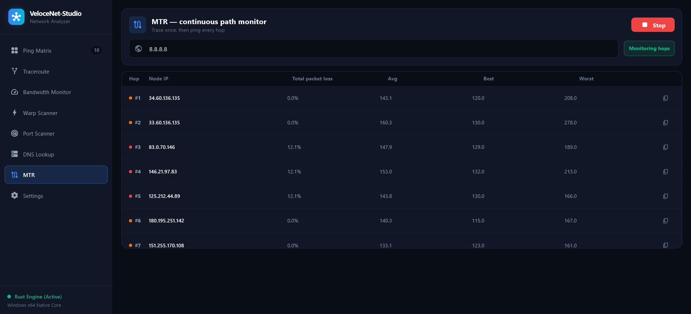 |

## Возможности

- **Пинг-матрица** — параллельные ICMP (через Windows IP Helper, без прав админа) + TCP-пробы, живые спарклайны, RTT средн/мин/макс, джиттер по RFC 3550, процент потерь, **журнал оповещений** о смене статуса с бейджем непрочитанных, **экспорт CSV** в один клик, версионированный **бэкап JSON** (экспорт + импорт вставкой) и **24-часовая история аптайма** каждой цели с отчётом об отключениях.
- **Трассировка** — визуальная цепочка хопов по TTL + таблица (нативный ICMP Windows), парсинг IPv4/IPv6, усреднённый RTT по нескольким пробам.
- **MTR** — одна трассировка, затем непрерывный пинг каждого отвечающего хопа (потери/средн/лучшее/худшее) на изолированном экземпляре движка.
- **Трафик** — живые дельты интерфейсов через `GetIfTable2` (64-битные счётчики), топ процессов по доле соединений (честно помечено как *оценка*).
- **Warp-сканер** — UDP-пробы в духе WireGuard + TCP-фолбэк, ранжирование, копирование в буфер, добавление в матрицу в один клик.
- **Сканер портов** — TCP-перебор по списку (`80,443,8000-8010`), статусы открыт/закрыт/фильтруется, угадывание сервисов.
- **DNS-запросы** — чистый UDP-клиент для записей A/AAAA/MX/TXT/NS/CNAME/SOA через Cloudflare/Google/Quad9 или свой сервер, с различением NXDOMAIN и показом времени запроса.
- **Настройки** — тема светлая / тёмная / системная + язык English / فارسی / Русский / 中文, сохраняются через `shared_preferences` (по умолчанию English), плюс вебхуки оповещений Telegram/Discord с кнопками теста.
- **Живучий движок** — если `.dll`/`.so` Rust не собран, приложение автоматически работает на резервном пробере Dart, так что UI доступен всегда.

## Скачать (v1.3.0)

Собирать ничего не нужно — выберите платформу в
[релизе v1.3.0](https://github.com/Cadman021/VeloceNet-Studio/releases/tag/v1.3.0):

| Платформа | Файл | Запуск |
|---|---|---|
| Windows x64 | `velocenet-studio-windows-x64.zip` | Распакуйте и запустите `.exe` (DLL рядом в архиве) |
| Linux x64 | `velocenet-studio-linux-x64.tar.gz` | Распакуйте и запустите бинарь `netstudio` (`.so` рядом в архиве) |
| macOS arm64 | `velocenet-studio-macos-arm64.zip` | Распакуйте, правый клик по `.app` → Открыть (сборка без подписи, разовое подтверждение Gatekeeper) |

Нативный ICMP-проби‌нг пока только под Windows; на Linux/macOS эти пробы прозрачно уходят в TCP. Что нового — см. [CHANGELOG.md](CHANGELOG.md).

## Сборка из исходников (Windows)

Требования: Flutter SDK ≥ 3.22 · стабильный Rust (`rustup`) · Windows 10/11 x64 для полного нативного функционала.

```powershell
.\build_native.ps1      # cargo build --release + stage netstudio_engine.dll
flutter pub get
flutter run -d windows
```

Вручную:

```powershell
cd native_engine
cargo build --release
Copy-Item target\release\netstudio_engine.dll ..
cd ..
flutter run -d windows
```

Linux/macOS: `cargo build --release` даёт `libnetstudio_engine.so` / `.dylib`; где нет raw-сокетов, ICMP уступает место TCP.

## Как это работает

```
┌──────────── Flutter UI ────────────┐      ┌────────── Rust engine ──────────┐
│ Ping Matrix · Traceroute · MTR     │ JSON │ Tokio probers (ICMP/TCP/TTL)    │
│ Bandwidth · Warp · Portscan · DNS  │◄────►│ stats (RTT/jitter/loss)         │
│ SettingsController (theme+locale)  │  FFI │ traceroute / bandwidth / warp   │
└────────────────────────────────────┘      └─────────────────────────────────┘
```

- Граница FFI: `lib/core/ffi/` (Dart) ↔ `native_engine/src/ffi.rs` (C ABI). Все строки валидируются в Dart до пересечения; числовые диапазоны clamp'ятся с обеих сторон.
- Нативная библиотека грузится только по **абсолютным путям от каталога исполняемого файла** — никакого cwd/`PATH` (защита от DLL-hijacking).
- Состояние: `PingMatrixController`, `TracerouteController`, `BandwidthController`, `WarpController`, `SettingsController` (все на `ChangeNotifier`).

## Структура проекта

```
lib/
  main.dart                      # асинхронный старт + загрузка SettingsController
  core/ffi/                      # native_library.dart, native_bindings.dart
  core/theme/                    # app_colors.dart, app_theme.dart, theme_x.dart
  core/settings/                 # settings_controller.dart (тема+язык)
  core/i18n/                     # AppStrings на JSON (en/fa/ru/zh, по умолчанию en)
  models/ services/ state/       # в т.ч. alert_log.dart (история смен статуса)
  views/
    main_shell_view.dart         # сайдбар + вкладки IndexedStack
    ping_matrix/ traceroute/ bandwidth/ warp/ portscan/ dnslookup/ settings/
native_engine/src/
  engine.rs ffi.rs stats.rs probe/ traceroute.rs bandwidth.rs warp.rs
.github/workflows/              # ci.yml, release.yml
docs/screenshots/               # картинки выше
```

## Заметки о безопасности

- Никакого поиска DLL в cwd/`PATH`; нет движка → резервный пробер Dart (никогда не падает).
- Ввод Warp-скана ограничен (256 КБ / 4096 эндпоинтов); IPv6 обрабатывается явно (в скобках `[::1]:port`).
- Трафик процессов — это **оценка по доле соединений** (Windows без ETW не даёт побайтовых счётчиков на PID) — в UI так и написано.

## Как контрибьютить

См. [CONTRIBUTING.md](CONTRIBUTING.md). Коротко:

```bash
flutter analyze --no-pub
flutter test --no-pub
cd native_engine && cargo test --release && cargo clippy --release -- -D warnings
```

Новые строки UI — только через JSON-словари в `assets/lang/` (все четыре локали — это проверяет `test/i18n_parity_test.dart`); новые цвета — через `ThemeX`. Баги и фичи — через шаблоны ишью.

## Чейнджлог и планы

См. [CHANGELOG.md](CHANGELOG.md). Ближайшие идеи: нативный ICMP на Linux/macOS, Prometheus-экспорт, честный per-process учёт (ETW), десктоп-уведомления об алертах.
